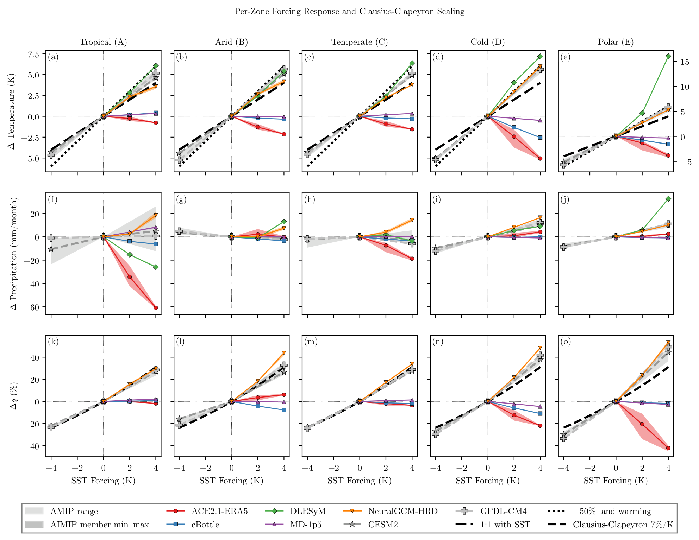

# How Do AI Climate Models Respond to Warming Across Climate Zones?
[](https://doi.org/10.5281/zenodo.24422410)

**Paper:** Charlotte C. Merchant, Milan Klöwer, Bradley Stanley-Clamp, Maren Höver, Simon L. L. Michel, Edward Groot, and Hannah M. Christensen (2026). [arXiv:2608.17986](https://arxiv.org/abs/2608.17986)

Code for evaluating AI climate models under prescribed sea-surface temperature (SST) warming. We use Köppen–Geiger climate zones to compare five AIMIP Phase 1 models with ERA5 (1979–2014) and physics-based AMIP models.

## Summary

Present-day climate-zone agreement does not guarantee a physically consistent warming response. Among the five AI models studied, NeuralGCM-HRD shows the broadest agreement with AMIP and thermodynamic scaling; other models show weak, excessive, or opposite-signed responses.



**Figure 3.** Responses relative to each model's baseline across five climate zones. Colors show AIMIP means and member ranges; grey shading shows the AMIP range. Reference lines show land-warming and Clausius–Clapeyron scaling. Models without specific humidity are omitted from the bottom row.

## Installation

Requires Python 3.11–3.13 and `uv`. From the repository root:

```bash
curl -LsSf https://astral.sh/uv/install.sh | sh
source "$HOME/.local/bin/env"
uv sync --extra test
```

## Getting started

Download the ERA5, AIMIP, and AMIP inputs following the [data guide](code/data/README.md#required-data), then set their paths in [`code/figures/config.py`](code/figures/config.py).

```bash
# Generate one figure
uv run python -m code.figures.fig_baseline_differences

# Generate all figures sequentially; progress is logged to run_figs.log
uv run bash run_figs.sh

# Run tests
uv run python -m pytest
```

Figures are saved to `code/figures/pdfs/`. See the [figure guide](code/figures/README.md) for individual scripts and analysis details. The batch runner currently uses an absolute project path; update its `cd` line when running elsewhere.

## Repository overview

- [`code/data/`](code/data/README.md): ERA5, AIMIP, and AMIP data loaders and input requirements.
- [`code/cluster/`](code/cluster/README.md): Köppen–Geiger climate classification.
- [`code/figures/`](code/figures/README.md): Analysis and figure generation.
- [`test/`](test/): Tests for data loading and classification.
- [`era5_classification.npz`](era5_classification.npz): Cached ERA5 baseline classification.
